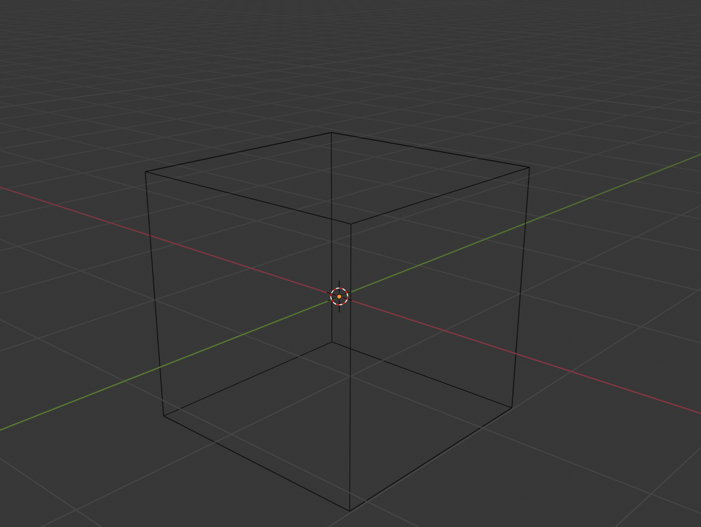
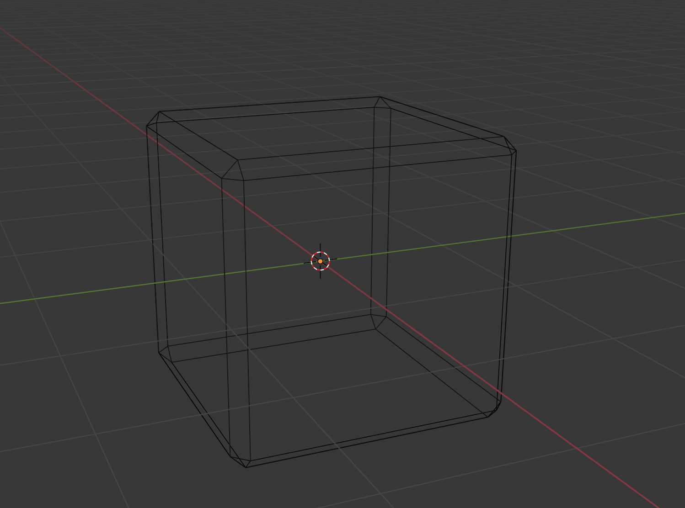
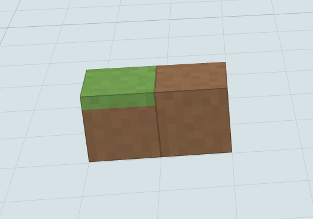

作为 [Pokémon Pokopia](https://pokopia.pokemon.com/en-us/) 粉丝，同时身为游戏开发者，我必须来尝试复刻一波 Pokopia 的地形渲染

Pokopia和minecraft不一样的地方在于，它是圆角正方体而非minecraft中的标准正方体

在Blender中利用倒角工具可以很容易看出区别

对于Minecraft来说，方块的顶面和底面是没有邻接变化的，而Pokopia中是有的，例如草方块的顶面邻接了一个泥方块，那么草方块的顶面会向上覆盖一部分泥方块的纹理，形成一个凸出的过渡效果

例如MC中草方块旁边放泥土，草方块和泥土和单独放置没有任何区别
但是在pokopia中则不是这样
